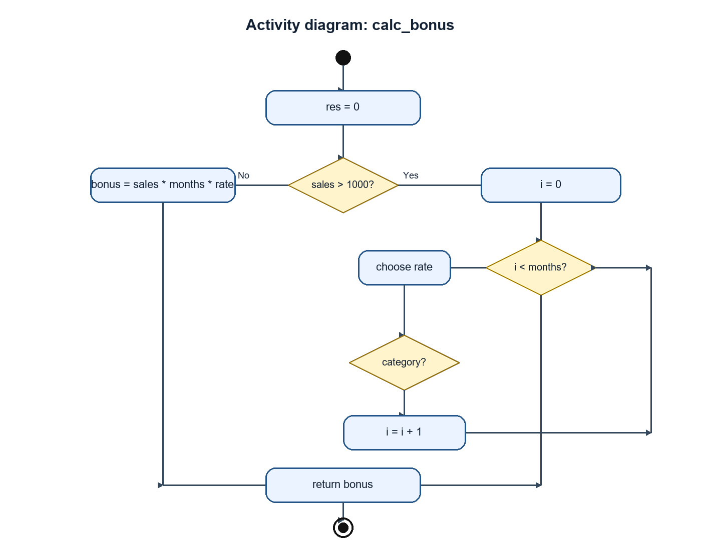
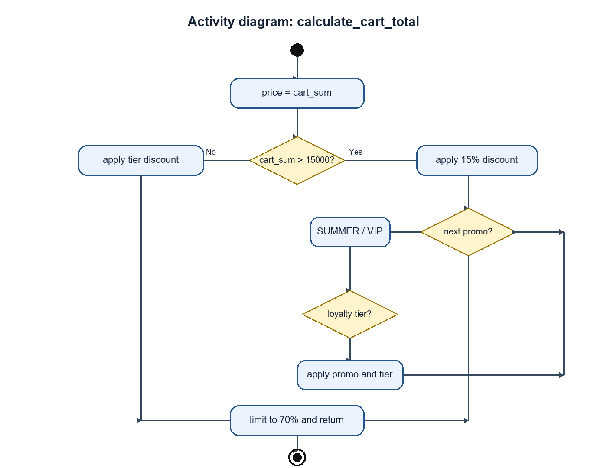

# Итоговый аналитический отчет Лабораторная работа 1

## 1 Резюме

В репозитории подготовлен базовый процесс разработки микросервиса расчёта корзины и скидок: модель ветвления, стандарты форматирования, владельцы кода, автоматическая проверка качества, артефакты обратного проектирования и план ревью. Основной результат - воспроизводимый набор правил, который снижает риск ошибочных расчётов и неуправляемых изменений.

## 2 Сравнительный анализ технологий

### 2.1 Матрица принятия решений

| Критерий | Вес | PostgreSQL | MongoDB |
|---|---:|---:|---:|
| ACID и целостность транзакций | 0.35 | 5 | 3 |
| Согласованность истории баллов и промокодов | 0.25 | 5 | 3 |
| Производительность транзакционного чтения | 0.15 | 4 | 4 |
| Гибкость схемы | 0.10 | 3 | 5 |
| Экосистема и стоимость владения | 0.15 | 5 | 4 |
| **Взвешенная оценка** | **1.00** | **4.65** | **3.55** |

### 2.2 Расчёт и выбор

Формула: `оценка = Σ(вес критерия × балл кандидата)`. Для PostgreSQL: `0.35×5 + 0.25×5 + 0.15×4 + 0.10×3 + 0.15×5 = 4.65`. Победитель - PostgreSQL: его строгие транзакции и ограничения целостности важнее гибкости схемы при работе с баллами, промокодами и финансовой историей.

## 3 Архитектура и контроль версий

Модель ветвления использует `main` как стабильную линию, `develop` как интеграционную ветку и feature-ветки для изолированных изменений. Владение кодом определено в [.github/CODEOWNERS](.github/CODEOWNERS), правила редактирования - в [.editorconfig](.editorconfig). Изменения в `develop` проходят через pull request.

## 4 Инструментальный контроль качества

Проверка flake8 описана в [.github/workflows/lint-check.yml](.github/workflows/lint-check.yml). Конфигурация ограничивает длину строки 80 символами. Исправленный пример обработки транзакции в `src/fixed_transaction.py` показывает устранение неинициализированного статуса, мёртвого присваивания и утечки файлового ресурса.

## 5 Обратное проектирование и планирование ревью

### 5.1 Анализ алгоритма

Диаграмма алгоритма бонусов: 

Диаграмма активности для алгоритма расчёта корзины: 

Code smells legacy-кода: магические числа, невыразительные имена параметров и глубокая вложенность.

### 5.2 План code review

План находится в [docs/review-plan.md](docs/review-plan.md). Он устанавливает измеримые критерии для расчётов, валидации, тестов и эскалации разногласий.

## 6 Заключение

Разделение веток, владельцы кода, CI и формализованное ревью уменьшают риск дефектов до попадания изменений в стабильную ветку. Матрица решений делает выбор технологии проверяемым, а диаграммы и анализ упрощают сопровождение legacy-логики.
